# Assignment 6: jQuery Portfolio

**Name:** Yerkebulan Korganbek

**Group:** IT-2501

## Project URLs

GitHub repository: https://github.com/Erkosh-IT/Erkosh-IT.github.io

GitHub Pages: https://erkosh-it.github.io/assignment6/

## How to open the project

Open assignment6/index.html, or use the website link above. All tasks are on one page. An internet connection is needed because jQuery 3.7.1 loads from the CDN shown in the lecture.

## Part 1: Getting Started with jQuery

### Task 0: Setup

I included jQuery before script.js. The code runs inside $(document).ready(function () { ... }). It prints "jQuery is ready!" in the browser console and shows the same message on the page.

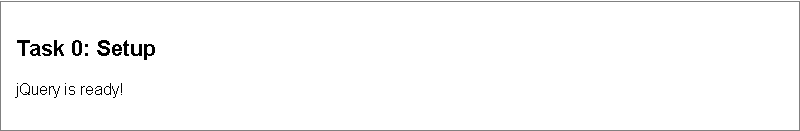

### Task 1: Selectors and CSS

The profile section contains my name, a headline, and a short introduction. A tag selector changes the h2 font size, an ID selector updates the headline with .text(), and a class selector makes the introduction italic with .css().

The Light Theme and Dark Theme buttons change the page colors with .css().

Light theme:

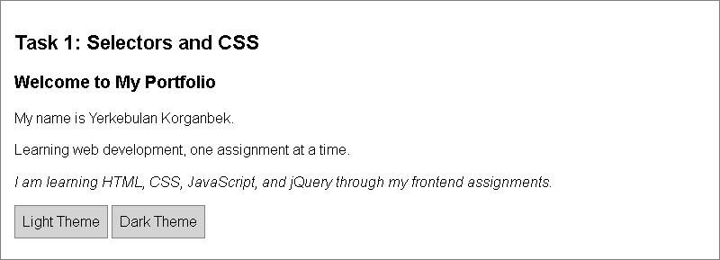

Dark theme:

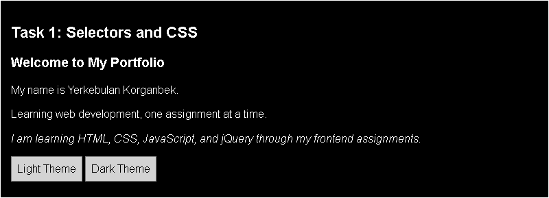

## Part 2: jQuery Effects

### Task 2: Visibility Methods

The About Me section includes a short biography, my current learning status, and a few facts about my coursework. Hide, Show, and Toggle control the status and facts using .hide(), .show(), and .toggle().

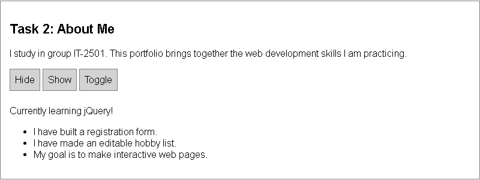

### Task 3: Fade Methods

The gallery contains screenshots from my previous forms and JavaScript assignments. The three buttons use .fadeIn(), .fadeOut(), and .fadeToggle() on both images. Each fade takes 400 milliseconds.

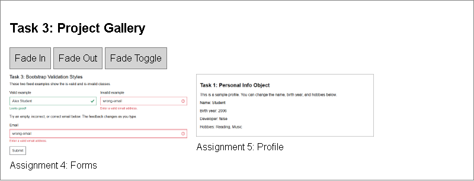

### Task 4: Slide Methods

There are three clickable headings about my HTML, CSS, and JavaScript practice. Clicking a heading uses .slideToggle() on its panel. Open All uses .slideDown(), and Close All uses .slideUp().

The screenshot shows all three panels open.

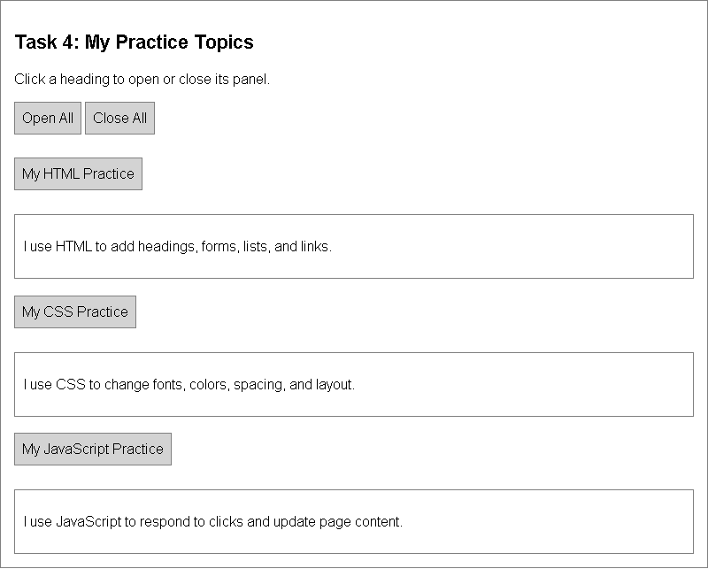

## Part 3: DOM Manipulation with jQuery

### Task 5: Add and Remove Elements

The skills list starts with HTML, CSS, JavaScript, and jQuery. Add Skill uses .append() to add a skill at the end. Prepend Skill uses .prepend() to add it at the beginning. Empty or space-only input is rejected.

Here I added Git at the end and Python at the beginning:

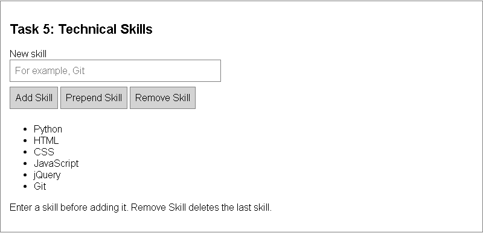

Remove Skill uses .remove() on the last list item. If the list is empty, it shows a message instead. In this screenshot, Git has been removed.

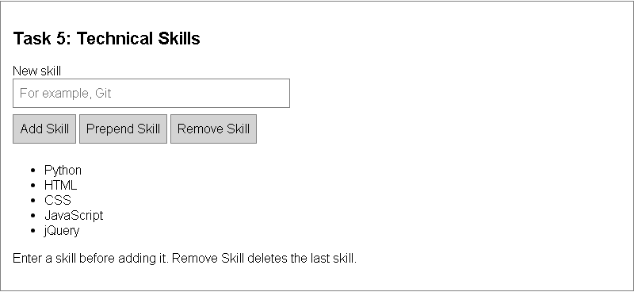

### Task 6: Modifying Attributes

The link initially opens my GitHub profile. Pressing Link to My Repository changes its href with .attr() and updates its text.

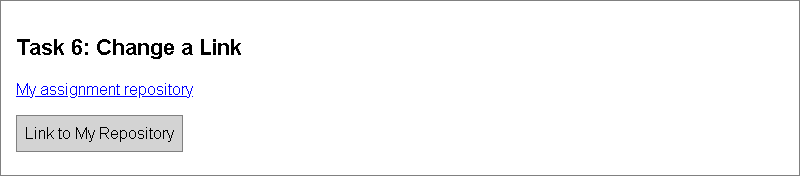

### Task 7: Form Interaction

The form has Name and Email inputs. As I type, .val() reads each value and .text() displays it below the form. This is a live preview; the form does not send the details anywhere.

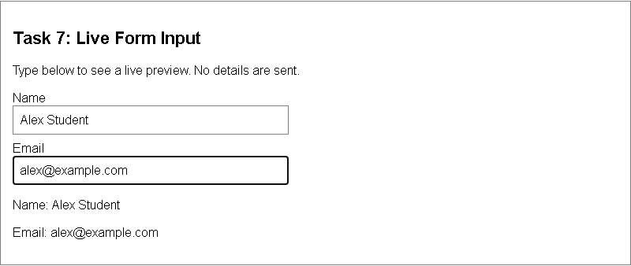

## Part 4: Animations

### Task 8: Animated Skill Bars

Three bars represent HTML, CSS, and JavaScript from the skills list. They start at zero width.

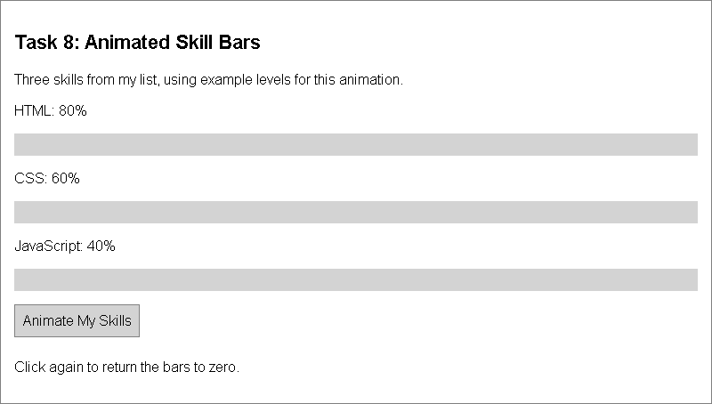

Animate My Skills uses .animate() to grow the bars to 80%, 60%, and 40%. These are example levels for the exercise. Clicking again animates all bars back to zero. A boolean variable keeps track of which action comes next.

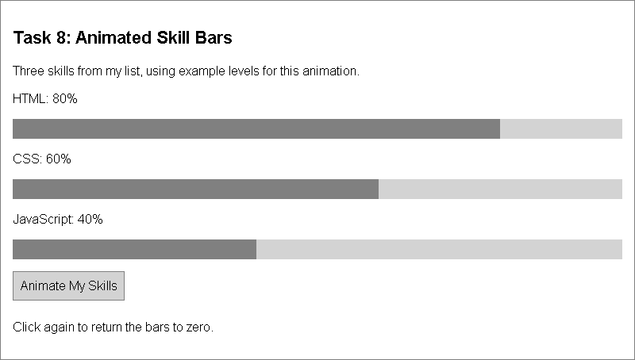

## Work Summary

I made the portfolio sections first, then added the jQuery handlers for each task. I tested both themes, all visibility effects, adding and removing skills, changing the link, and typing into the form. I also checked that the skill bars return to zero on the next click and that the page fits smaller screens.

## Resources

Week8_frontend.pdf and the Assignment 6 requirements.

[Provided jQuery lecture playlist](https://www.youtube.com/playlist?list=PLPT6CF0r4E3oCA-JwzCc9fgWz6-6mVp-4)

Gallery images: screenshots from my Assignments 4 and 5.

## Previous Assignments

[Assignment 1 report](assignment1/README.md)

[Assignment 2 report](assignment2/README.md)

[Assignment 3 report](assignment3/README.md)

[Assignment 4 report](assignment4/README.md)

[Assignment 5 report](assignment5/README.md)
