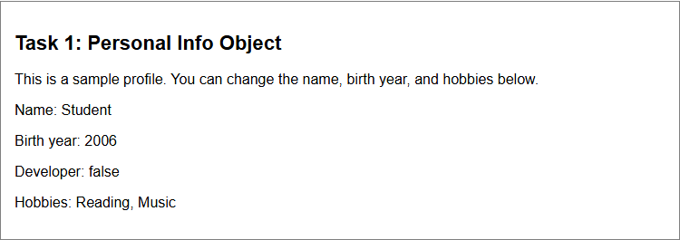
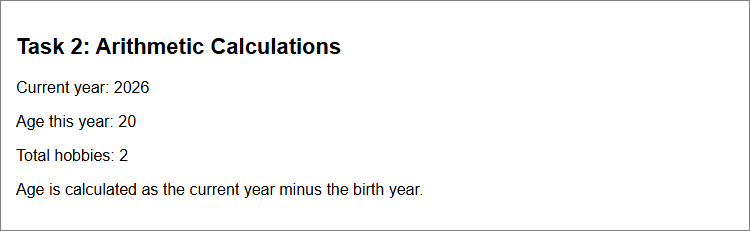
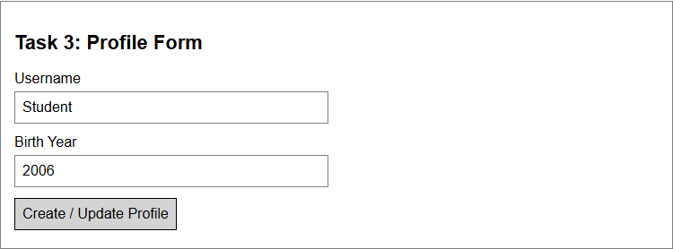
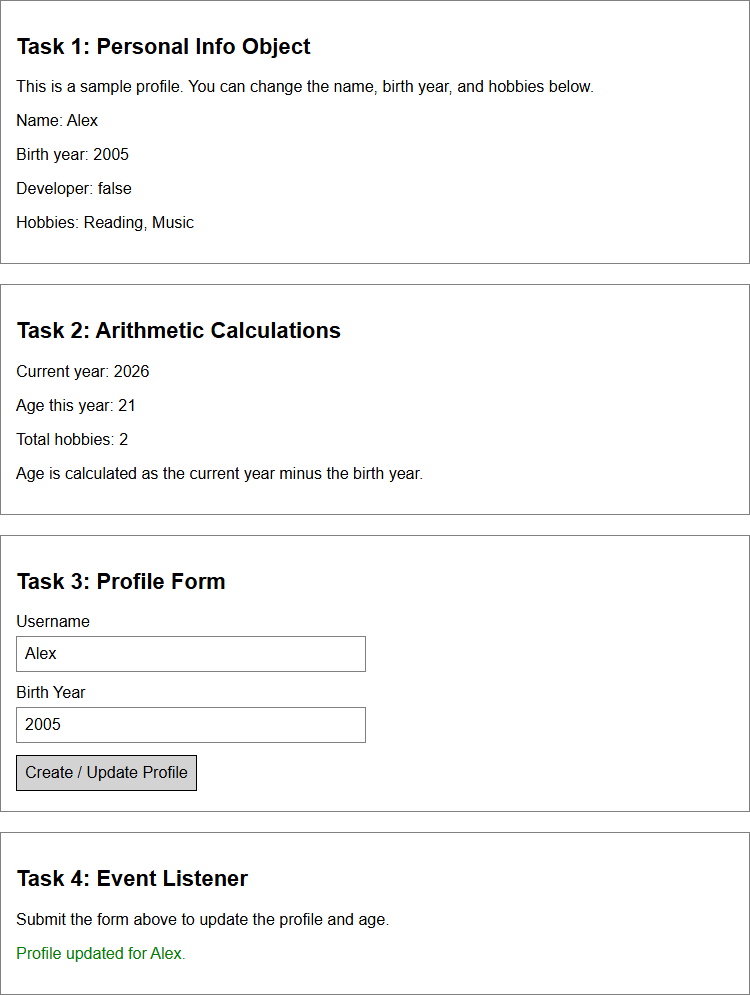
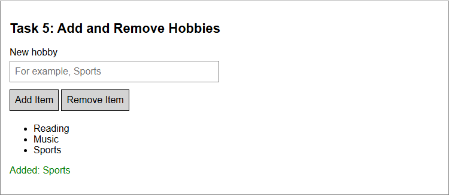
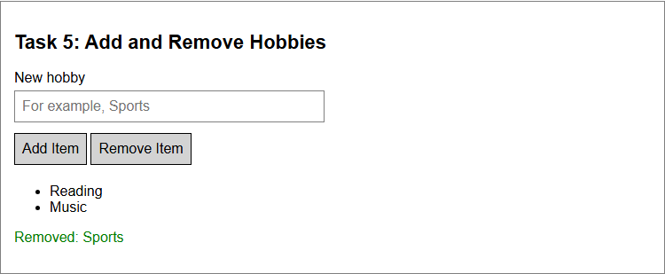

# Assignment 5: JavaScript Basics

**Name:** Yerkebulan Korganbek

**Group:** IT-2501

## Project URLs

GitHub repository: https://github.com/Erkosh-IT/Erkosh-IT.github.io

GitHub Pages: https://erkosh-it.github.io/assignment5/

## How to open the project

Open assignment5/index.html, or use the website link above. All five tasks are on one page. The project has an HTML file, a CSS file, and a JavaScript file. It also works offline.

The page starts with a sample profile. Changes are kept while the page is open and reset when it is reloaded.

## Part 1: Profile Object, Data Types and Arithmetic

### Task 1: Personal Info Object

I created a const object named userProfile. It stores a name as a string, a birth year as a number, isDeveloper as a boolean, and hobbies as an array. The starting profile uses Student, 2006, false, and two sample hobbies.

The values are displayed on the page and the object is logged in the browser console.

### Task 2: Arithmetic Calculations

The current year comes from new Date().getFullYear(). I subtract the birth year to calculate the age the person turns that year. Since the form only asks for a birth year, it does not check whether their birthday has passed.

The page also shows the total number of hobbies using the array's length. Both results are printed in the console and updated when the profile or hobby list changes.

## Part 2: Form Input and Event Responses

### Task 3: HTML Form

The form has a Username input, a Birth Year input, and a Create / Update Profile button. Both fields are required. Birth year accepts whole numbers from 1900 to the current year.

### Task 4: Event Listener

The submit listener reads the form values and updates userProfile. Number() converts the birth year input into a number. The page then shows the updated profile and recalculates the age without reloading.

The message becomes green after an update. A username containing only spaces produces a red message. In the screenshot, I changed the sample profile to Alex, born in 2005.

## Part 3: DOM List Manipulation

### Task 5: Creating and Removing Elements

The hobby list starts with Reading and Music. Add Item creates a new li element with createElement and adds it with appendChild. It also adds the hobby to the array. Empty or space-only entries are not added.

After adding Sports:

Remove Item removes the last li with removeChild and removes the last hobby from the array. The profile's hobby names and total stay in sync with the list. If the list is empty, a message says there is nothing to remove.

After removing Sports:

## Work Summary

I started with the profile object and calculations, then added the form and its submit listener. After that, I added the hobby list buttons. I tested profile updates, invalid birth years, adding hobbies, and removing every item from the list. I also checked the page at different screen widths.

## Resources

Week7_frontend_new.pdf: variables, data types, operators, type conversion, functions, and console output.

Javascript_DOM.pdf: selecting elements, changing text and styles, objects, and event listeners.

Assignment 5 requirements: creating and removing list elements and calculating age dynamically.

## Previous Assignments

[Assignment 1 report](assignment1/README.md)

[Assignment 2 report](assignment2/README.md)

[Assignment 3 report](assignment3/README.md)

[Assignment 4 report](assignment4/README.md)
