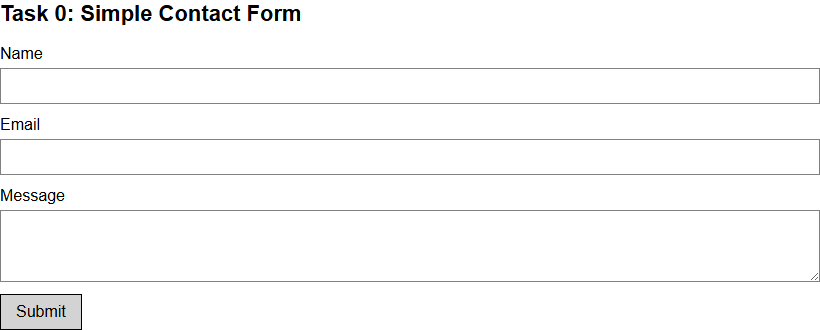
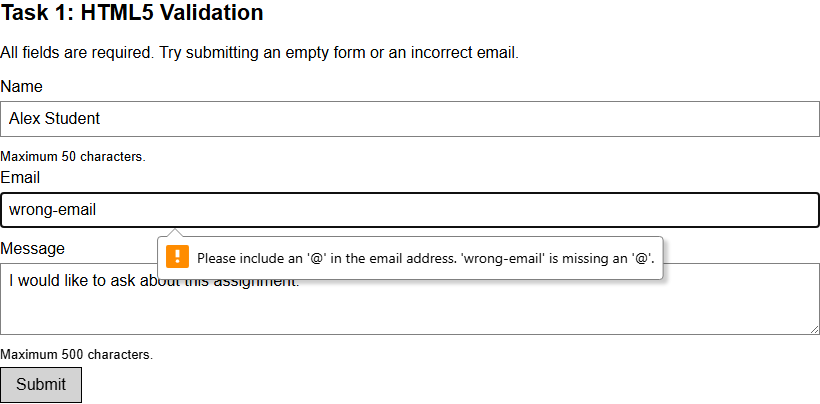
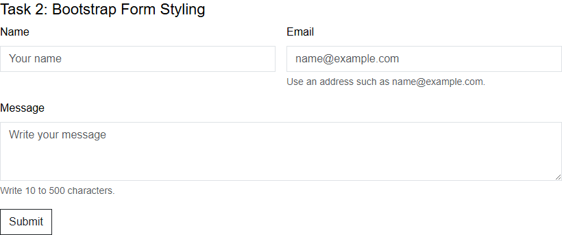
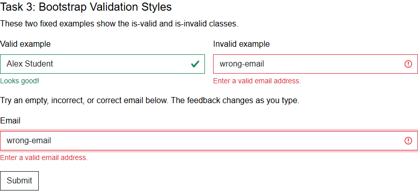
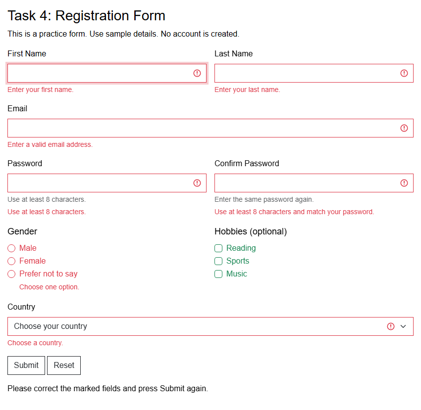
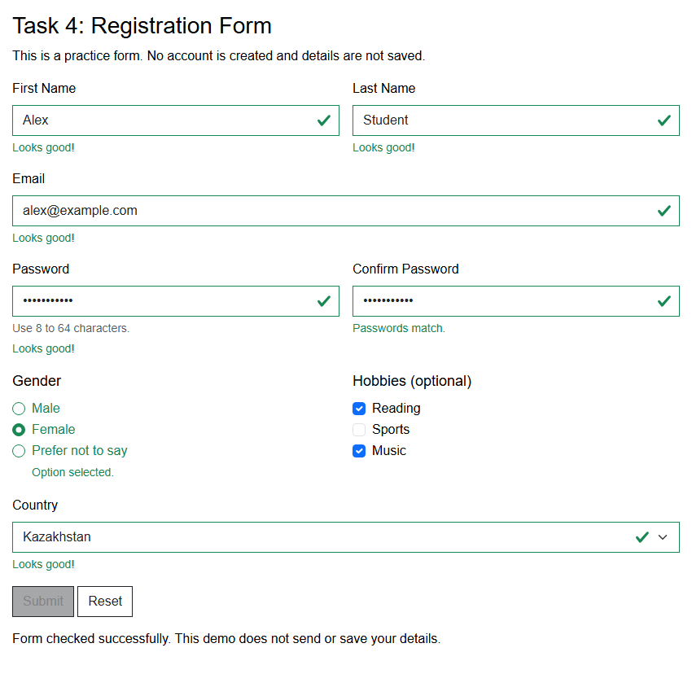
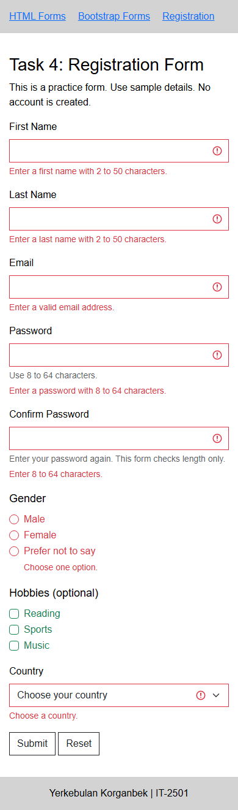

# Assignment 4: Forms and Validation

**Name:** Yerkebulan Korganbek

**Group:** IT-2501

## Project URL

https://github.com/Erkosh-IT/Erkosh-IT.github.io

Website: https://erkosh-it.github.io/assignment4/

## How to open the project

Open index.html in this folder, or use the website link above. The navigation links open the Bootstrap forms and registration page. Bootstrap is included in the project, so the pages also work offline.

These are practice forms made with HTML, CSS, and Bootstrap CSS. Task 4 also uses a small JavaScript file for password matching and feedback after Submit. Use sample details when testing. Tasks 0 to 3 open a completion page using GET, so named fields appear in the URL. Task 4 stays on the registration page and does not send the entered details or create an account.

## Task 0: Simple Contact Form

The first form has a name field, an email field, a message box, and a Submit button. Each field has a label connected to it using matching for and id values.

## Task 1: HTML5 Validation

All three fields are required. The name has a maximum of 50 characters, and the message has a maximum of 500 characters. The email field uses type="email". The browser stops submission if a required field is empty or the email format is incorrect.

The screenshot shows an email without an @ symbol.

## Task 2: Bootstrap Form Styling

This is the contact form with Bootstrap styling. I used form-label for labels, form-control for inputs, and form-text for helper text. The fields also have placeholders.

The form uses row and g-3 for the layout and spacing. Name and email use col-12 and col-md-6, so they sit next to each other from 768px and stack on smaller screens. The message takes the full row.

## Task 3: Bootstrap Validation Styles

The two fixed examples show is-valid and is-invalid with messages below them. These classes are written directly in the HTML.

The email form below them uses Bootstrap's was-validated class. This lets Bootstrap CSS show feedback based on HTML5 validation. Feedback is visible from the start. An empty or incorrect email shows an error, and a correctly formatted email shows success. The browser also checks the form when Submit is pressed.

## Task 4: Registration Form

The registration form includes first and last name, email, password, password confirmation, gender, hobbies, and country. Gender uses radio buttons, so only one option can be selected. Hobbies use checkboxes and are optional, so several can be selected. Country uses a dropdown.

Both password fields need at least 8 characters. The registration.js file compares the passwords when Submit is pressed. It then adds was-validated to show Bootstrap error or success feedback. A message below the buttons says whether the form is correct. Editing a field hides the old feedback until Submit is pressed again. Reset clears the fields and feedback.

Feedback after submitting empty fields:

Correctly completed form with sample details:

The Bootstrap Grid places related fields beside each other on wider screens. Below 768px, the fields stack in one column.

## Work Summary

I made the basic contact form, added HTML validation, and then made the Bootstrap versions. I added a short script to Task 4 to compare passwords and show feedback after Submit. I checked empty fields, incorrect emails, short or different passwords, valid submissions, and the Reset button. I also checked the pages at mobile, tablet, and desktop widths.

## Resources

[Lecture playlist: Bootstrap basics](https://www.youtube.com/playlist?list=PLPT6CF0r4E3rkvy1rLUKdDHf_HmWZeURW)

[Bootstrap forms documentation](https://getbootstrap.com/docs/5.3/forms/overview/)

[Bootstrap validation documentation](https://getbootstrap.com/docs/5.3/forms/validation/)

[MDN form validation](https://developer.mozilla.org/en-US/docs/Learn_web_development/Extensions/Forms/Form_validation)

Bootstrap version: 5.3.3.

## Previous Assignments

[Assignment 1 report](../assignment1/README.md)

[Assignment 2 report](../assignment2/README.md)

[Assignment 3 report](../assignment3/README.md)
